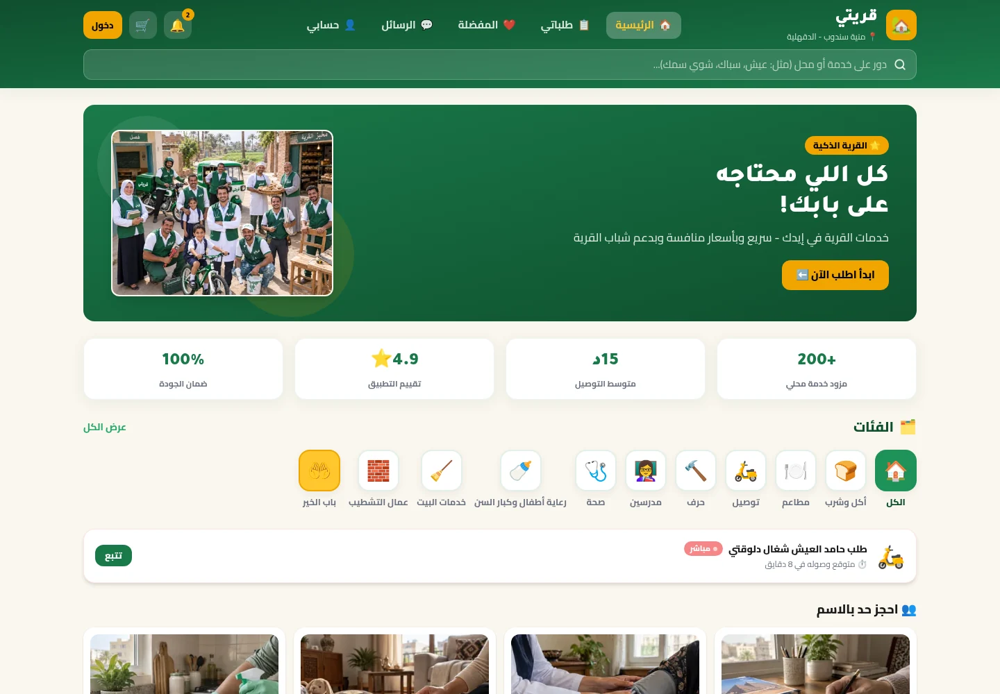
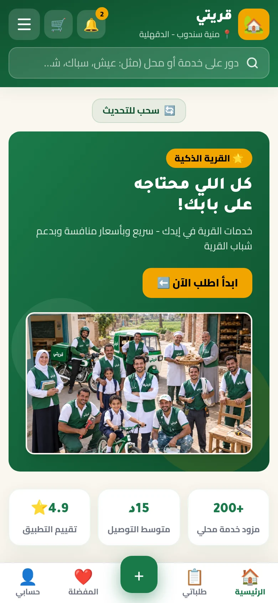
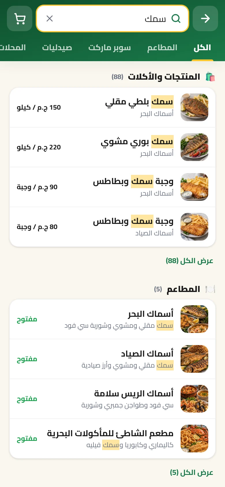
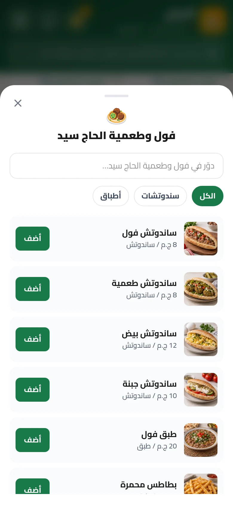
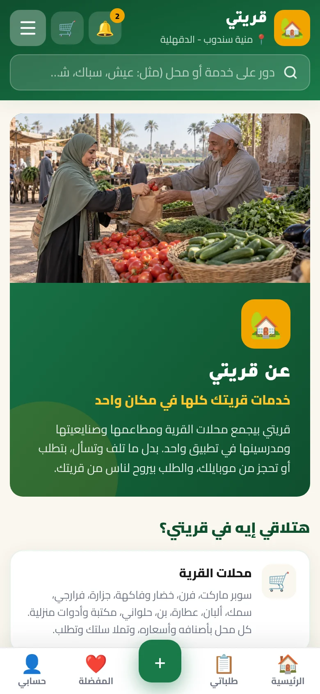

<div align="center">
  
  <h1>قريتي · Qaryati</h1>
  <p><strong>خدمات القرية الذكية في جيبك</strong></p>
  <p>محلات ومطاعم وخدمات وأهل قريتك، في مكان واحد.</p>
  <p>
    <a href="https://qaryaty.vercel.app/"><strong>افتح قريتي ↗</strong></a>
    &nbsp; · &nbsp;
    <a href="#screenshots">لقطات من الموقع</a>
    &nbsp; · &nbsp;
    <a href="#development">التشغيل محليًا</a>
  </p>
  <p><code>React 19</code> &nbsp; <code>TypeScript</code> &nbsp; <code>RTL</code> &nbsp; <code>PWA</code> &nbsp; <code>Supabase</code></p>
</div>



## من احتياج يومي إلى طلب واضح

قريتي تطبيق ويب عربي يجمع احتياجات الحياة في القرية: طلبات المحلات والمطاعم، البحث عن المنتجات، اختيار مقدمي الخدمات، وحجز المدرسين والصنايعية. التصميم يبدأ من الموبايل، مع تجربة أوسع على الكمبيوتر، واتجاه عربي من اليمين لليسار.

| اكتشف | اختار | تابع |
| :--- | :--- | :--- |
| بحث عربي في المنتجات والمحلات والخدمات والأشخاص | قوائم أصناف وأسعار وكميات، وبطاقات لمقدمي الخدمات | سلة طلبات، عنوان توصيل، وسجل لحالات الطلب |

<a id="screenshots"></a>

## تجربة قريتي، على الشاشة

لقطات فعلية من [الموقع المنشور](https://qaryaty.vercel.app/)، التُقطت في **6 نوفمبر 2026**. الموبايل بعرض 390 بكسل، والكمبيوتر بعرض 1440 بكسل. ليست تصميمات مقترحة أو صور واجهة مركبة.

<table>
  <tr>
    <th width="33%">الرئيسية</th>
    <th width="33%">البحث بالمنتج</th>
    <th width="33%">قائمة المطعم</th>
  </tr>
  <tr>
    <td></td>
    <td></td>
    <td></td>
  </tr>
</table>

<details>
<summary>شاهد صفحة «عن قريتي»</summary>
<br />

</details>

> بعض محتوى الكتالوج وأسماء مقدمي الخدمات والصور توضيحية أو خيالية. ظهورها في اللقطات لا يثبت وجود تاجر أو مقدم خدمة فعلي، أو توافر منتج، أو صحة أرقام الاستخدام والتقييمات الظاهرة. صور الأدوية ليست وسيلة لتحديد الدواء أو العبوة.

## ما الذي يقدمه المشروع؟

- **بحث عربي موحد:** يتعامل مع اختلافات الهمزات والتشكيل، ويعرض المنتجات والأكلات قبل المطاعم والمحلات، مع تبويبات لتصفية النتائج.
- **محلات ومطاعم:** قوائم مقسمة، بحث داخل القائمة، صور للأصناف، واختيار الكمية، مع سلة مرتبطة بمكان أو خدمة واحدة في كل مرة.
- **أشخاص وخدمات:** مدرسون، رعاية وتمريض، صنايعية، خدمات منزلية وتوصيل، وبطاقات لاختيار مقدم الخدمة وخيارات الحجز.
- **حساب وطلبات:** تسجيل ودخول، عنوان وقرية، مفضلة، وسجل طلبات. نقاط المكافآت الحالية محفوظة على الجهاز وليست رصيدًا ماليًا على الخادم.
- **حياة القرية:** وظائف، بيع مستعمل وتبادل، مشاركة المواصلات، مجموعات وباب الخير.
- **إدارة بصلاحيات:** لوحتا `/dashboard` و`/admin` مقيدتان بدور المسؤول. بعض أدوات لوحة مقدم الخدمة تحفظ بياناتها محليًا ولا تمثل تشغيلًا تجاريًا مكتملًا.
- **تطبيق ويب قابل للتثبيت:** إعداد PWA وService Worker لتخزين ملفات الواجهة وبعض الصور. تنفيذ الطلبات والدخول وجلب البيانات الحالية يحتاج اتصالًا بالشبكة.

## التقنية

| الجزء | المستخدم في المشروع |
| :--- | :--- |
| الواجهة | React 19، TypeScript، React Router |
| البناء والتنسيق | Vite 6، Tailwind CSS 4 |
| الحالة | Zustand مع حفظ انتقائي على الجهاز |
| النماذج والتحقق | Zod |
| البيانات والحسابات | Supabase: Auth، PostgreSQL، RLS |
| الخرائط والأيقونات | Leaflet، Lucide React |
| الاختبارات | Vitest |
| تثبيت التطبيق | vite-plugin-pwa، Workbox |
| الدفع الإلكتروني الاختياري | Paymob عبر Supabase Edge Functions |

<a id="development"></a>

## التشغيل محليًا

استخدم **Node.js 22** و**pnpm 10.34.9**، وهو الإصدار المثبت في `package.json`.

```bash
git clone https://github.com/alhinawi/qaryaty-smart-village.git
cd qaryaty-smart-village
corepack enable
pnpm install
cp .env.example .env.local
pnpm dev
```

افتح `http://localhost:5173/`.

### إعداد البيانات

**بدون ربط خادم:** اترك متغيرات Supabase فارغة. يعمل التطبيق بالكتالوج المرفق ومستودعات محلية داخل المتصفح، وليس بحسابات أو طلبات مشتركة بين الأجهزة.

**مع Supabase:** ضع القيم العامة للمشروع في `.env.local`:

```dotenv
VITE_SUPABASE_URL=https://your-project.supabase.co
VITE_SUPABASE_ANON_KEY=your-public-anon-key
```

1. في مشروع Supabase جديد أو بيئة منفصلة، راجع وشغّل [`supabase/schema.sql`](supabase/schema.sql)، ثم [`supabase/seed.sql`](supabase/seed.sql) عند الحاجة إلى الكتالوج المرفق.
2. راجع إعدادات Auth وروابط العودة للدومين المستخدم. الإيميل يحتاج إعداد تسليم مناسب؛ لا تفترض أن وصول رسالة التفعيل مضمون دون اختباره.
3. لا تضع مفتاح `service_role` أو مفاتيح الدفع السرية في متغيرات `VITE_*` أو ملفات الواجهة.
4. قبل أي تعديل لقاعدة بيانات قائمة: خذ نسخة احتياطية واختبر التغيير في بيئة منفصلة. لا تشغّل ملفات seed أو SQL إضافية على الإنتاج دون مراجعة.

يمكن فرض المستودعات المحلية حتى مع وجود إعدادات Supabase عبر `VITE_DATA_SOURCE=mock`.

### أوامر العمل

| الأمر | الوظيفة |
| :--- | :--- |
| `pnpm dev` | تشغيل خادم التطوير |
| `pnpm test` | تشغيل اختبارات Vitest |
| `pnpm build` | فحص TypeScript وبناء ملفات الإنتاج في `dist/` |
| `pnpm preview` | معاينة البناء محليًا |
| `pnpm lint` | تشغيل ESLint |
| `pnpm seed:sql` | توليد SQL للمراجعة فقط، من غير مسح أو استبدال السجلات الموجودة. ممنوع تشغيله على قاعدة حية قبل مراجعة مصدر بيانات الديمو وموافقة منفصلة |

## البيانات والأمان وحدود التشغيل

الصفحات تقرأ وتكتب عبر طبقة `src/repositories`، وليس عبر اتصال مباشر من كل مكون. الواجهات المشتركة لها مستودعات محلية ومستودعات Supabase؛ الاختيار في `src/repositories/index.ts`.

- سياسات **RLS** ووظائف SQL تحدد صلاحيات البيانات. إخفاء رابط أو صفحة في الواجهة ليس بديلًا عن صلاحيات الخادم.
- عند تعطل Supabase، قد يُعرض كتالوج محلي مع تنبيه. عمليات الكتابة المتصلة، مثل الطلبات والحسابات، لا تتحول بصمت إلى نجاح محلي.
- إجمالي الطلب ورسومه يجب أن يطابق حساب الخادم. العمولة الحالية 5%، مقربة لأقرب جنيه، بحد أدنى جنيه وحد أقصى 50 جنيهًا للطلب ذي المبلغ الموجب، مع إعفاءات وحالات سعر يحدد لاحقًا. المرجع هو [`src/config/commission.ts`](src/config/commission.ts) ونظيرته في SQL.
- الدفع عند الاستلام لا يحتاج ربط Paymob. تفعيل الدفع الإلكتروني يحتاج مفاتيح ووظائف خادم وإعداد webhook واختبارًا مستقلًا: [دليل Paymob](supabase/functions/README.md).
- الصور التوضيحية والمحتوى المرفق لا يغنيان عن مراجعة بيانات التجار والأسعار والتراخيص قبل التشغيل الفعلي.

## خريطة المشروع

```text
src/
├── components/       # الواجهة، البحث، القوائم، السلة والنماذج
├── pages/            # صفحات التطبيق ولوحتا الإدارة ومقدم الخدمة
├── repositories/     # واجهات البيانات وتنفيذها محليًا أو عبر Supabase
├── stores/           # حالة التطبيق باستخدام Zustand
├── data/             # الكتالوج والمحتوى المرفق
├── config/           # الأسعار والرسوم والعرض وإعدادات الخدمات
├── hooks/            # سلوك مشترك بين مكونات الواجهة
├── types/            # نماذج TypeScript
└── utils/            # البحث والتحقق وحسابات الطلبات
supabase/
├── schema.sql        # الجداول والسياسات ووظائف الخادم
├── seed.sql          # الكتالوج المولد
└── functions/        # وظائف الدفع
public/               # الصور والأيقونات والملفات العامة
docs/                 # لقطات الموقع وملاحظات المشروع
scripts/              # توليد البيانات وأدوات العمل
```

## النشر والمساهمة

ابنِ المشروع بالأمر `pnpm build` وانشر محتوى `dist/`. إعداد Vercel في [`vercel.json`](vercel.json) يعيد المسارات إلى التطبيق، حتى تعمل الروابط المباشرة للصفحات. اضبط متغيرات البيئة في منصة النشر ثم أعد البناء.

قبل رفع أي تعديل: شغّل الاختبارات والبناء، وراجع الصفحة على الموبايل والكمبيوتر. أرفق صورًا للتغييرات المرئية، ولا ترفع أسرارًا أو بيانات حسابات شخصية.

---

<div align="center">
  <strong>قريتي</strong><br />
  <sub>مشروع Mohamed Alhinawi · <a href="https://qaryaty.vercel.app/">qaryaty.vercel.app</a></sub>
</div>
